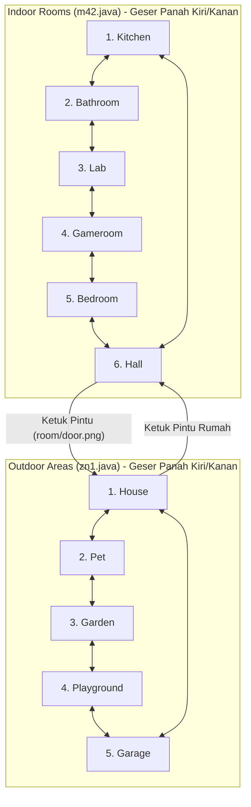

# Spesifikasi & Arsitektur Logika Pou (Source of Truth: APK 1.4.139 / Code 288)

Dokumen ini mendokumentasikan seluruh logika resmi, rumus matematis, state machine, struktur data, dan mekanika interaksi game **Pou** berdasarkan hasil ekstraksi dan dekompilasi bytecode APK aktif Android (`me.pou.app` versi `1.4.139`, versionCode `288`).

Dokumen ini adalah inventaris hasil dekompilasi, bukan bukti bahwa seluruh logika sudah terverifikasi atau sudah diterapkan di web. Versi APK perlu dicocokkan dengan berkas yang dianalisis: PARITY.md sebelumnya mencatat versi 1.4.138. Sebagian nama, konversi waktu, dan perilaku masih perlu diverifikasi melalui jalur pemanggilan dan pengujian pada aplikasi asli.

---

## 1. Arsitektur Engine & Game Loop

### 1.1 Siklus Tick & Frekuensi Eksekusi (`ti.java` & `AppView.java`)
Game loop utama Pou dieksekusi pada thread terpisah (`ti extends Thread`) dengan fixed timestep:
* **Penjadwalan:** `ti.java` menambah jadwal 16 ms per langkah (secara nominal 62,5 langkah per detik), dengan catch-up hingga 100 langkah. Ini tidak sama persis dengan 60 Hz.
* **Pemanggilan:** `AppView.t(double time)` memperbarui tampilan; jumlah pemanggilan `zp2.N` melalui semua jalur masih perlu diverifikasi sebelum mengonversi konstanta ke laju nyata.
* **Konversi Waktu ke Tick:**
  * 1 detik = 60 tick.
  * 1 menit = 3.600 tick.
  * 1 jam = 216.000 tick.

### 1.2 Logika Offline / Catch-Up Saat Game Dibuka Kembali (`zp2.java:827`)
Ketika game dimuat dari penyimpanan, selisih waktu dihitung dengan:
$$\Delta t_{\text{detik}} = t_{\text{sekarang}} - t_{\text{terakhir}}$$
Konversi ke tick:
$$d = \Delta t_{\text{detik}} \times 60.0$$
* **Peredam catch-up:**
  Kode membagi nilai dengan 3 kecuali kedua timestamp berada pada hari dan bulan yang sama serta `(jamAwal >= 3 || jamAkhir < 6)`. Ini adalah kondisi kode, bukan pembagian akurat hanya untuk bagian rentang pukul 03.00–06.00:
  $$d_{\text{efektif}} = \frac{d}{3.0}$$
Fungsi utama `N(d, ...)` kemudian dipanggil satu kali. Hasilnya tidak sepenuhnya deterministik karena kemunculan kotoran menggunakan `Math.random()`.

---

## 2. Sistem Status Utama (Needs) & Rumus Penurunan

Semua status bernilai antara $0.0$ hingga $100.0$ (`defpackage/zp2.java:375-490`).
Angka per jam di bawah memakai asumsi 216.000 satuan `d` per jam; konversi ini belum terbukti sama dengan waktu nyata pada seluruh jalur update.

### 2.1 Fullness / Rasa Kenyang (`this.k`)
* **Laju Penurunan:**
  $$\Delta k = -6.481 \times 10^{-5} \times d$$
* **Per 216.000 satuan `d`:** **$-13.999\%$**; padanan per jam nyata masih perlu verifikasi jalur update.
* **Ambang Batas Lapar:**
  Jika $k < 30.0\%$, Pou masuk ke status lapar (`this.m = true`, ekspresi mulut cemberut / lapar).

### 2.2 Fun / Kesenangan (`this.u`)
* **Laju Penurunan:**
  $$\Delta u = -4.05 \times 10^{-5} \times d$$
* **Per Jam (216.000 tick):** **$-8.748\%$** ($\approx -8.75\%$ per jam).
* **Ambang Batas Bosan:**
  Jika $u < 30.0\%$, Pou bosan dan ingin bermain (`this.u < 30.0`).

### 2.3 Energy / Energi (`this.x`)
* **Kondisi Terjaga (Lampu Menyala / Lampu Mati tapi Belum Tidur):**
  $$\Delta x = -5.4 \times 10^{-5} \times d$$
  * **Per Jam:** **$-11.664\%$ per jam** (~8.5 jam dari 100% sampai habis).
  * **Ambang Batas Mengantuk:**
    Jika $x < 30.0\%$:
    * Jika lampu mati (`!this.w`): Pou otomatis tertidur (`this.y = true`).
    * Jika lampu menyala (`this.w`): Pou memperlihatkan ekspresi mata sayu/mengantuk (`this.z = true`).
* **Kondisi Tidur (Lampu Mati, `this.y == true`):**
  $$\Delta x = +3.24 \times 10^{-4} \times d$$
  * **Per Jam:** **$+69.984\%$ per jam** ($\approx +70\%$ per jam).
  * **Lama Pengisian Penuh:** Sekitar **85,7 menit** (1 jam 25 menit) dari 0% ke 100%.
  * **Bangun Otomatis:** Ketika $x \ge 100.0\%$, Pou otomatis bangun (`this.y = false`), lampu tidak otomatis menyala, dan pemain dihadiahi **+50 XP** (`this.a(50, ...)`).

### 2.4 Health / Kesehatan (`this.p`)
Kesehatan menurun secara pasif bergantung pada kebersihan Pou:
* **Kondisi Bersih (`!this.t`):**
  $$\Delta p = -9.645 \times 10^{-6} \times d \quad (\approx -2.083\% \text{ per jam})$$
* **Kondisi Kotor (`this.t`):**
  $$\Delta p = -1.286 \times 10^{-5} \times d \quad (\approx -2.778\% \text{ per jam})$$
* **Ambang Batas Sakit:**
  Jika $p < 50.0\%$, Pou masuk ke kondisi sakit (`this.q = true`, ekspresi sakit / termometer).

### 2.5 Obesitas / Lemak (`this.l`)
* Akumulasi terjadi ketika Pou diberi makan saat rasa kenyang sudah mencapai $100.0\%$:
  $$l_{\text{baru}} = \min(l + (k_{\text{baru}} - 100.0), 100.0)$$
* **Pembakaran Lemak Alami (Metabolisme):**
  $$\Delta l = -3.858 \times 10^{-5} \times d \quad (\approx -8.333\% \text{ per jam})$$

### 2.6 Formula Kebahagiaan Total (`this.v`)
Pou tidak menggunakan rata-rata aritmatika biasa, melainkan rumus bobot:
$$\text{Total} = (u \times 0.4) + (k \times 0.2) + (x \times 0.2) + (p \times 0.2)$$
* **Fun:** Bobot 40%
* **Fullness:** Bobot 20%
* **Energy:** Bobot 20%
* **Health:** Bobot 20%

### 2.7 Mengelus / Menggelitik Pou (`zp2.java:1000`, `m42.java:1545`)
Ketika jari pemain digeser/diusap di atas tubuh Pou:
* Poin Kesenangan bertambah: $\Delta u = +0.03888$ per sentuhan.
* Energi berkurang sedikit: $\Delta x = -1.62 \times 10^{-4}$.
* Lemak terbakar sedikit: $\Delta l = -1.1574 \times 10^{-4}$.
* Pou tertawa geli/tersenyum dan mengeluarkan animasi kedip gembira.

---

## 3. Sistem Ruangan & Navigasi (Indoor vs Outdoor)

Di Pou resmi, hierarki ruangan dipisahkan secara struktural:



### 3.1 Daftar 6 Ruangan Indoor (`m42.java`)
1. **Kitchen (ID 1, `xz1.J2`):**
   * Rak Makanan (`fridges/fridge.png`) untuk membuka inventaris makanan.
   * Tempat memberi makan Pou.
2. **Bathroom (ID 2, `xz1.o`):**
   * Sabun (`soaps`) untuk menggosok badan.
   * Shower (`showers`) untuk membilas busa sabun.
   * Area munculnya Kotoran (Poop).
3. **Lab (ID 3, `xz1.L2`):**
   * Rak Ramuan (`shelves/shelf.png`) berisi 8 ramuan resmi.
4. **Gameroom (ID 4, `xz1.f2`):**
   * Bola pantul (`balls`). Memantulkan bola: Fun $+2.5\%$, Energy $-0.2\%$ per pantulan (`zp2.java:162`).
   * Tombol Game (`room/joystick.png`) untuk membuka katalog 32 minigame.
5. **Bedroom (ID 5, `xz1.r`):**
   * Lampu tidur (`lamps`) untuk mematikan/menyalakan lampu (tidur/bangun).
   * Lemari (`closets/closet.png`) untuk kustomisasi pakaian, topi, warna tubuh, mata.
6. **Hall (ID 6, `xz1.t2`):**
   * Mikrofon (`room/micro.png`) untuk fitur mendengar suara dan mengulangi dengan nada tinggi (2.0x pitch shift).
   * Pintu keluar (`room/door.png`) menuju area Outdoor.

### 3.2 Daftar 5 Area Outdoor (`zn1.java`)
1. **House (ID 1, `xz1.B2`):** Halaman depan, kustomisasi atap (`roofs`), dinding luar (`scenes`), warna jendela/pintu, dan pintu kembali ke Hall.
2. **Pet (ID 2, `xz1.e4`):** Hewan peliharaan luar rumah (6 spesies, kustomisasi warna).
3. **Garden (ID 3, `xz1.k2`):** 5 pot bunga yang bisa layu dan disiram air.
4. **Playground (ID 4, `xz1.t4`):** Gawang bola (Goal penalty), ring basket (Hoops), dan kolam renang (Pool).
5. **Garage (ID 5, `xz1.i2`):** Mobil, modifikasi warna/velg, upgrade mesin/suspensi, dan game Hill Drive.

---

## 4. Logika Kamar Mandi, Sabun, Shower, & Kotoran (Poop)

### 4.1 Mekanisme Mandi Realistis (`m42.java:490-540`, `1480-1540`)
* **Shower Tidak Bisa Membersihkan Kotoran Langsung:**
  Pemain tidak dapat membersihkan Pou hanya dengan menyiram shower.
* **Tahap 1: Menggosok Sabun (`this.Y0`):**
  * Ketika sabun diseret menyentuh tubuh Pou (`x0.y(soap)`), busa sabun (`this.f1`) muncul menempel pada posisi sentuh.
  * Ketika busa sabun telah mencakup tubuh Pou (`x0.K(this)`), status kotor ditandai siap dibilas (`this.d1 = true`), dan shower mulai berkedip/aktif.
* **Tahap 2: Membilas dengan Shower (`this.P0`):**
  * Shower mengeluarkan tetesan air (`clouds/raindrop.png`).
  * Tetesan air yang menyentuh busa sabun menghilangkan gelembung tersebut.
* **Tahap 3: Selesai Bersih:**
  * Setelah seluruh busa sabun habis terbilas (`z2 && z3`):
    * Pou menjadi bersih total (`this.j.t = false`, `x0.a()`).
    * Hadiah **+5 Koin** diberikan (`this.j.D.j.a(5)`).
    * Suara `ap2.A` diputar.

### 4.2 Siklus Kemunculan Kotoran / Poop (`zp2.java:400`, `it1.java`)
* Timer kotoran `this.r` memiliki nilai dasar **21.600.000 ms (6 jam)**.
* Setiap tick, timer berkurang sebesar 16 ms.
* **Pengaruh Makanan:** Setiap kali Pou makan, timer kotoran dipercepat sebesar **30 menit** (`this.r -= 1800000`).
* Ketika timer $\le 0$:
  * Timer di-reset kembali ke $21.600.000\text{ ms}$.
  * Pou menjadi kotor (`dirty = true`).
  * Peluang 50% (`Math.random() < 0.5`) memunculkan entitas Poop (`it1`).
* **Interaksi Poop:**
  * Poop memiliki mata yang melirik ke arah sentuhan.
  * Mengetuk Poop: memutar suara `ap2.p`, menghilangkan kotoran dari ruangan, mengurangi hitungan poop (`this.s--`), dan memberikan **+5 Koin** (`this.D.k.a(5)`).

---

## 5. Logika Makan, Nutrisi, Pertumbuhan & Penolakan

### 5.1 Pemberian Makan (`zp2.java:1018-1065`, `dj0.java`)
Setiap makanan memiliki atribut:
* $p$: Poin Kenyang (Fullness)
* $q$: Poin Kesenangan (Fun)
* $r$: Poin Kesehatan (Health)

Efek saat dikonsumsi:
1. $k_{\text{baru}} = k + p$. Jika $k > 100.0$, kelebihannya menambah obesitas $l$.
2. $p_{\text{baru}} = \text{clamp}(p + r, 0, 100)$.
   * Contoh: Cabai (ID 358) memiliki $r = -30$, mengurangi kesehatan sebesar 30 poin.
3. $u_{\text{baru}} = \min(u + q, 100)$.
   * Makanan manis dan sarapan memberikan $q = +5$ poin Fun.
4. **Pertumbuhan Ukuran Badan:**
   $$\Delta \text{size} = p \times 2.976 \times 10^{-4}$$
   Ukuran (`this.j`) tumbuh bertahap dari 0.5 (Bayi) hingga 1.0 (Dewasa).
5. **Pemicu Kotoran:** `this.r -= 1800000` (mengurangi 30 menit dari timer kotoran).

### 5.2 Logika Penolakan Makanan (`zp2.java:490-506`)
Ketika makanan diseret ke mulut Pou, fungsi `P(food)` mengecek apakah Pou mau makan:
* Jika Kenyang $< 30\%$: **Selalu mau makan** (`accept = true`).
* Jika Kenyang $\ge 30\%$:
  * Ada peluang 10% menolak secara acak (`Math.random() <= 0.1`).
  * Jika Kenyang $\ge 90\%$: Peluang menolak meningkat drastis sebanding dengan obesitas:
    $$\text{Peluang Tolak} = \frac{\text{Obesitas}}{100}$$
  * Jika menolak, Pou menggelengkan kepala dan bersuara "No / No-no".

---

## 6. Katalog 8 Ramuan Resmi Lab (`pt1.java`)

Tidak ada ramuan buatan (seperti racun atau penawar non-resmi). Hanya 8 ramuan berikut yang ada di APK asli:

| ID | Nama Ramuan | Biaya (Koin) | Efek Stat | Syarat Penolakan |
| :--- | :--- | :--- | :--- | :--- |
| **2** | **Small Health Potion** (`do2`) | 6 | Health +25, XP +15 | Ditolak jika Health $\ge 90\%$ |
| **1** | **Health Potion** (`tu0`) | 10 | Health +50, XP +25 | Ditolak jika Health $\ge 90\%$ |
| **3** | **Fat Burner** (`yf0`) | 20 | Obesitas $l = 0.0$, XP +25 | Ditolak jika Obesitas $\le 10\%$ |
| **4** | **Energizer** (`bc0`) | 50 | Energy $x = 100.0$, XP +40 | Ditolak jika Energy $\ge 90\%$ |
| **8** | **Max Potion** (`jd1`) | 99 | Semua stat (k, p, u, x) menjadi 100 | Ditolak jika semua stat $\ge 90\%$ |
| **5** | **Hunger Potion** (`gx0`) | 199 | Fullness $k = 0.0$, XP +50 | Ditolak jika Fullness $\le 90\%$ |
| **6** | **Baby Potion** (`yj`) | 1.999 / IAP | Ukuran tubuh $j = 0.5$ (Bayi), XP +100 | Ditolak jika ukuran $\le 0.75$ |
| **7** | **Adult Potion** (`w3`) | 3.999 / IAP | Ukuran tubuh $j = 1.0$ (Dewasa), XP +100 | Ditolak jika ukuran $\ge 1.0$ |

---

## 7. Sistem Level, Progresi XP & Hadiah

### 7.1 Kebutuhan XP per Level (`zp2.java:823`, `c62.java`)
Pou menghitung batas XP untuk naik ke level berikutnya secara linier:
$$\text{XP}_{\text{level}} = (\text{Level Saat Ini} + 1) \times 55$$

* Level 1 $\rightarrow$ 2: $2 \times 55 = 110\text{ XP}$
* Level 2 $\rightarrow$ 3: $3 \times 55 = 165\text{ XP}$
* Level 3 $\rightarrow$ 4: $4 \times 55 = 220\text{ XP}$
* **Level Maksimum:** Level **270** (`zp2.w0 = new c62(270)`).

### 7.2 Hadiah Naik Level (`zp2.java:520`)
Ketika XP mencapai target level:
$$\text{Koin Hadiah} = \min(\text{Level Baru} \times 10, 250)$$
Pemain menerima popup perayaan level baru, suara perayaan, dan koin langsung ditambahkan.

---

## 8. Logika Kebun Bunga (`mi0.java`, `bp0.java`, `zp2.java:175`)

* Kebun memiliki **5 pot bunga tetap** (`mi0.java:18`).
* **Timer Layu:**
  Timer air/layu `this.A` bernilai dasar **21.600.000 ms (6 jam)**.
  Ketika timer habis, seluruh bunga menjadi layu (`withered = true`, batang membungkuk ke bawah $100^\circ$).
* **Penyiraman:**
  * Pemain menyiram bunga menggunakan gembor air.
  * Tetesan air yang mengenai bunga layu memicu animasi bunga tegak kembali (`bp0.J()`).
  * Hadiah setiap menyiram bunga layu: **+15 XP dan +5 Koin** (`zp2.java:181-182`).
  * Bunga tidak dipanen lalu hilang; bunga adalah tanaman hias permanen yang warnanya bisa dikustomisasi.

---

## 9. Sistem Minigame (32 Game Lengkap) & Ekonomi Koin

### 9.1 Katalog 32 Minigame Resmi (`xn0.java`, `wo0.java`)
| ID | Nama Minigame | Kelas Implementasi | Tipe & Kontrol |
| :---: | :--- | :--- | :--- |
| **1** | Food Drop | `fj0.java` | Menangkap makanan, hindari sampah (`shoe`, `cd`, `horseshoe`). |
| **2** | Sky Jump | `wn2.java` | Melompat di platform, sensor tilt / miring perangkat. 4 layer latar langit/angkasa (`ground_sky`, `sky_upper`, `upper_space`, `space_heaven`). |
| **3** | Free Fall | `nl0.java` | Menukik ke bawah melewati celah awan. |
| **4** | Color Match | `hw.java` | Mencocokkan warna bola/lingkaran. |
| **5** | Sad Tap | `s52.java` | Ketuk Pou yang berwajah sedih, hindari Pou ceria. |
| **6** | Pou Sounds | `du1.java` | Simon says dengan nada piano Pou. |
| **7** | Pou Popper | `zt1.java` | Bubble shooter / memecahkan kumpulan warna Pou. |
| **8** | Tic Tac Pou | `tv2.java` | Tic-tac-toe vs bot / 2 pemain. |
| **9** | Four Pous | `ck0.java` | Connect four (4 berturut-turut). |
| **10** | Find Pou | `tg0.java` | Mencari Pou di balik cangkir yang diacak (Shell game). |
| **11** | Match Tap | `zc1.java` | Ketuk 3 atau lebih ubin warna yang bersambung. |
| **12** | Color Tap | `kw.java` | Mengetuk Pou dengan warna yang diminta. |
| **13** | Memory | `qd1.java` | Membalik kartu dan mencocokkan pasangan gambar. |
| **14** | Connect | `wy.java` | Menghubungkan jalur warna tanpa bertubrukan. |
| **15** | Goal | Playground (`AppView.o(4,1)`) | Tendangan penalti gawang sepak bola di halaman luar. |
| **16** | Cloud Pass | `ru.java` | Melompat melewati awan bergerak. |
| **17** | Cliff Jump | `du.java` | Mengendarai sepeda/skate melompati jurang batu. |
| **18** | Pool | Playground (`AppView.o(4,2)`) | Memantulkan Pou melompat di kolam renang luar. |
| **19** | Water Hop | `c53.java` | Melompati kayu apung di atas air. |
| **20** | Sky Hop | `pn2.java` | Melompat di platform awan vertikal. |
| **21** | Hill Drive | `bv0.java` | Mengemudi mobil melewati bukit naik-turun. |
| **22** | Cliff Dash | `yt.java` | Berlari kencang di tebing menghindari rintangan. |
| **23** | Word Find | `n93.java` | Permainan tebak / cari kata dalam kisi-kisi huruf. |
| **24** | Pet Walk | `br1.java` | Mengajak anjing peliharaan jalan-jalan di luar. |
| **25** | Jet Pou | `a21.java` | Flappy-bird style dengan roket / jetpack Pou. |
| **26** | Hoops | `zv0.java` | Melempar bola basket ke ring. |
| **27** | Tumble | `vx2.java` | Menjaga keseimbangan Pou di atas balok berputar. |
| **28** | Sudoku | `ts2.java` | Permainan angka Sudoku klasik. |
| **29** | Star Popper | `tp2.java` | Memecahkan ubin bintang berwarna. |
| **30** | Food Swap | `uj0.java` | Match-3 puzzle makanan (geser 2 makanan untuk cocokkan 3). |
| **31** | Beach Volley | `hl.java` | Bola voli pantai dengan Pou lain. |
| **32** | Connect 2 | `sy.java` | Varian teka-teki menghubungkan ubin pasangan berjarak. |

### 9.2 Sistem Pembayaran Koin Minigame (`uo0.java:488`, `ao0.java:323`)
* **Bukan Rumus `floor(skor / 3)`:**
  Di game aksi (seperti Sky Jump, Free Fall, Jet Pou, Cliff Jump), koin yang didapat adalah **koin fisik yang berhasil disentuh/diambil di layar** (`W(int coin)`).
* **Hubungan Koin & XP:**
  Setiap 1 koin yang diambil dalam minigame memberikan **1 Koin dan 1 XP** pada layar Game Over (`ao0.java:323`: `this.b.a(this.J, this.e)`).

---

## 10. Fitur Hewan Peliharaan Outdoor / Pet (`kq1.java`, `jq1.java`)

Di area Outdoor 2 (*Pet*), Pou memiliki hewan peliharaan tersendiri:
* **6 Spesies Resmi (`jq1.java`):**
  1. `pet_hamster` (Hamster, ID 60, Biaya 1.499 koin, Level 20)
  2. `pet_rabbit` (Kelinci)
  3. `pet_pig` (Babi)
  4. `pet_monkey` (Monyet)
  5. `pet_cat` (Kucing)
  6. `pet_dog` (Anjing)
* **Kustomisasi Pet:**
  * Warna badan (`bodCol`)
  * Warna kepala (`hedCol`)
  * Warna hidung (`nosCol`)
  * Warna kaki/cakar (`fetCol`)
  * Warna mata (`eyeColors`)
  * Bulu mata (`eyelashes`)
* **Interaksi Pet:**
  * Pet mengikuti gerakan Pou.
  * Bisa dielus, diajak bermain, dan diajak jalan-jalan keluar rumah pada minigame **Pet Walk** (`br1.java`).

---

## 11. Fitur Garasi & Mobil (`tq.java`, `qq.java`, `pq.java`)

Di area Outdoor 5 (*Garage*), Pou memiliki mobil yang dapat dikendarai:
* **4 Model Mobil (`qq.java`):**
  1. Mobil Klasik / Buggy (`je1.java`, ID 3, 2.499 koin, Level 30)
  2. Mobil Sport (`wl.java`)
  3. Mobil Sedan (`ya3.java`)
  4. Truk / 4x4 (`ht.java`)
* **Kustomisasi & Upgrade Mobil:**
  * Warna cat bodi (`carCol`)
  * Model & warna velg (`carWhl`)
  * Upgrade Mesin / Kecepatan Maksimum (`H(h2Var)`)
  * Upgrade Suspensi / Pegas (`G(h2Var)`)
  * Upgrade Akselerasi (`J(h2Var)`)
* Digunakan untuk balapan bukit di minigame **Hill Drive** (`bv0.java`).

---

## 12. Sistem Mikrofon & Suara Echo (`l43.java`, `zo2.java`)

Di Hall (Ruangan 6), terdapat mikrofon (`room/micro.png`):
* **Perekaman Audio:**
  * Format: Mono 16-bit PCM, Sample Rate **44.100 Hz** (`AudioRecord`).
  * Deteksi Otomatis: Mulai merekam saat suara melebihi ambang batas desibel (`iAbs > this.g`), dan berhenti ketika terjadi keheningan selama $0.4\text{ detik}$ (`this.l`).
  * Durasi Maksimum: **10 detik** (`this.h = 10`).
* **Algoritma Pitch Shifting (`zo2.java`):**
  * Menggunakan library DSP Sonic.
  * Faktor Pitch Shift resmi Pou adalah **2.0x (Satu Oktaf Lebih Tinggi)** (`zo2Var.B(2.0f)`), bukan 1.35x.
* **Sinkronisasi Animasi Mulut:**
  * Selama pemutaran suara (`AudioTrack`), mulut Pou bergerak terbuka/tertutup secara dinamis mengikuti amplitudo RMS audio (`m42.c.a.c(float amplitude)`).

---

## 13. Sistem Prestasi / Achievements Lengkap (`y1.java`)

Pou memiliki lebih dari 80 Achievement resmi dengan pelacak stat:
1. **Level Milestone (ID 101–107):** Capai Level 1, 50, 100, 250, 500, 1000, 5000.
2. **Food Tasted (ID 111–193):** Mencicipi setiap kategori makanan sebanyak 1, 3, dan 9 kali.
3. **Feed Pou (ID 201–207):** Memberi makan Pou sebanyak 1, 10, 50, 100, 500, 1000, 5000 kali.
4. **Clean Pou (ID 301–307):** Memandikan Pou sebanyak 1, 10, 50, 100, 500, 1000, 5000 kali.
5. **Energize Pou (ID 401–407):** Menidurkan / memberi Energizer sebanyak 1, 10, 50, 100, 500, 1000, 5000 kali.
6. **Water Flowers (ID 801–807):** Menyiram bunga kebun sebanyak 1, 10, 50, 100, 500, 1000, 5000 kali.
7. **Game Highscores (ID 511–785):** Mencapai skor tertentu pada 32 minigame.
* **Hadiah:** Setiap tier achievement memberikan koin (50, 100, 150, 200, 250, 300, 350 koin) yang tercatat pada `this.D.h` (`fA`).

---

## 14. Lapisan Kostum & Kustomisasi Penampilan Pou

Rangkuman urutan layer render visual kanvas Pou dari bawah ke atas:
1. Bayangan dasar lantai
2. Warna bodi utama (`tm N` / `bodyColors`)
3. Pola stiker / bintik bodi
4. Mulut & Lidah
5. Mata: Warna mata (`sd0 O`), Eyeline (`pe0 R`), Eyeshadow (`tf0 Q`), Eyelashes (`hf0 P`), Alis (`ae0 S`)
6. Kumis (`wf1 T`) & Jenggot (`sl U`)
7. Lipstik bibir (`w91 V`)
8. Baju / Outfit / Dress (`uq2 a0`) & Kostum binatang (`pc1 r0`)
9. Dasi / Kalung / Syal (`zt0 Z`)
10. Kacamata (`mu0 Y`)
11. Rambut Palsu / Wig (`un1 W`)
12. Topi (`w73 X`)
13. Topeng (`wm2 p0`)
14. Sayap belakang (`kn2 q0`)

---

## 15. Struktur Data Simpanan (Save State) Resmi (`me.pou.app_preferences.xml`)

Penyimpanan Pou menyimpan field JSON berikut:
```json
{
  "time": 1794028176.284,
  "rC": 285,
  "size": 0.5068,
  "fullness": 51.86,
  "obesity": 0,
  "light": 1,
  "energy": 89.05,
  "sleeping": 0,
  "health": 99.78,
  "nDM": 21348916,
  "dirty": 1,
  "fun": 79.29,
  "lvl": 1,
  "xp": 87,
  "poops": 0,
  "nWM": 21318724,
  "withered": 1,
  "witheredF": 1,
  "coins": "{\"g\":200,\"b\":0,\"x\":0,\"s\":0,\"t\":0,\"fL\":0,\"fA\":50,\"fT\":0,\"fC\":0,\"fP\":0,\"fG\":0,\"fF\":0}",
  "wallpapers": "{\"i\":[...],\"k\":2,\"t\":11,\"l\":7,\"g\":5,\"b\":6,\"h\":3,\"e\":4}",
  "food": "{\"i\":[{\"i\":201,\"g\":3},{\"i\":304,\"g\":5}]}",
  "potions": "{\"i\":[{\"i\":1,\"g\":2}]}",
  "showers": "{\"i\":[{\"i\":103,\"g\":1}],\"a\":103}",
  "soaps": "{\"i\":[{\"i\":113,\"g\":1}],\"a\":113}",
  "balls": "{\"g\":[118],\"a\":118}",
  "games": "{\"i\":[{\"i\":21,\"g\":1}]}",
  "carMod": "{\"i\":[{\"i\":3,\"g\":1,\"carCol\":...,\"carWhl\":...}],\"a\":3}",
  "petKnd": "{\"i\":[{\"i\":60,\"g\":1,\"bodCol\":...,\"hedCol\":...}],\"a\":60}",
  "achievements": [101]
}
```

### Keterangan Field Koin (`hv.java`):
* `g`: Koin awal gratis (200).
* `b`: Koin yang dibeli lewat In-App Purchase.
* `s`: Total koin yang telah dibelanjakan (spent).
* `fL`: Akumulasi koin dari kenaikan level.
* `fA`: Akumulasi koin dari klaim achievement.
* `fT`: Akumulasi koin dari bonus harian (treat).
* `fC`: Akumulasi koin dari memandikan Pou bersih (+5 koin).
* `fP`: Akumulasi koin dari membersihkan kotoran/poop (+5 koin).
* `fG`: Akumulasi koin dari bermain minigame.
* `fF`: Akumulasi koin dari menyiram bunga kebun (+5 koin).
* `fVA`: Akumulasi koin dari menonton video iklan.
* **Total Saldo Koin:**
  $$\text{Saldo} = \max(0, (g + b + x + f_L + f_A + f_T + f_C + f_P + f_G + f_F + f_{\text{VA}}) - s - t)$$
